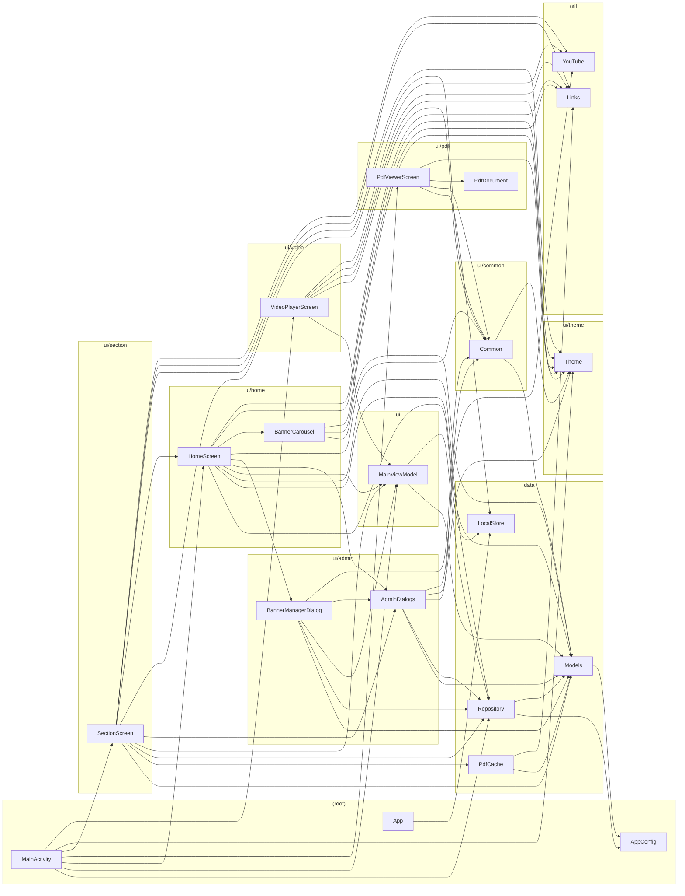

# Code review graph

Generated by `scripts/code_review_graph.py` from the Kotlin sources under `app/src`. Regenerate after changing the code with `python3 scripts/code_review_graph.py`.

- Files: **20** (3696 lines)
- Public top-level declarations: **51**
- Dependency edges between files: **59**

An arrow `A --> B` means `A` uses something `B` declares. To see what a change affects, run `python3 scripts/code_review_graph.py --impact <base-ref>`.

## Diagram

## Hotspots

Files that many others depend on. A change here has the widest blast radius.

| File | Used by | Uses |
|---|---|---|
| `main/java/com/elementsofmathematics/app/data/Models.kt` | 9 | 1 |
| `main/java/com/elementsofmathematics/app/ui/theme/Theme.kt` | 8 | 0 |
| `main/java/com/elementsofmathematics/app/data/Repository.kt` | 6 | 2 |
| `main/java/com/elementsofmathematics/app/ui/common/Common.kt` | 6 | 2 |
| `main/java/com/elementsofmathematics/app/ui/MainViewModel.kt` | 5 | 2 |
| `main/java/com/elementsofmathematics/app/util/Links.kt` | 5 | 0 |
| `main/java/com/elementsofmathematics/app/data/LocalStore.kt` | 3 | 0 |
| `main/java/com/elementsofmathematics/app/ui/admin/AdminDialogs.kt` | 3 | 5 |

## Files

| File | Lines | Public declarations | Used by | Uses |
|---|---:|---:|---:|---:|
| `main/java/com/elementsofmathematics/app/data/Models.kt` | 70 | 9 | 9 | 1 |
| `main/java/com/elementsofmathematics/app/ui/theme/Theme.kt` | 41 | 9 | 8 | 0 |
| `main/java/com/elementsofmathematics/app/data/Repository.kt` | 241 | 1 | 6 | 2 |
| `main/java/com/elementsofmathematics/app/ui/common/Common.kt` | 135 | 5 | 6 | 2 |
| `main/java/com/elementsofmathematics/app/ui/MainViewModel.kt` | 71 | 1 | 5 | 2 |
| `main/java/com/elementsofmathematics/app/util/Links.kt` | 58 | 1 | 5 | 0 |
| `main/java/com/elementsofmathematics/app/data/LocalStore.kt` | 67 | 3 | 3 | 0 |
| `main/java/com/elementsofmathematics/app/ui/admin/AdminDialogs.kt` | 439 | 7 | 3 | 5 |
| `main/java/com/elementsofmathematics/app/util/YouTube.kt` | 22 | 1 | 3 | 0 |
| `main/java/com/elementsofmathematics/app/AppConfig.kt` | 20 | 1 | 2 | 0 |
| `main/java/com/elementsofmathematics/app/ui/home/HomeScreen.kt` | 520 | 3 | 2 | 10 |
| `main/java/com/elementsofmathematics/app/data/PdfCache.kt` | 86 | 1 | 1 | 2 |
| `main/java/com/elementsofmathematics/app/ui/admin/BannerManagerDialog.kt` | 272 | 1 | 1 | 5 |
| `main/java/com/elementsofmathematics/app/ui/home/BannerCarousel.kt` | 144 | 1 | 1 | 3 |
| `main/java/com/elementsofmathematics/app/ui/pdf/PdfDocument.kt` | 80 | 1 | 1 | 0 |
| `main/java/com/elementsofmathematics/app/ui/pdf/PdfViewerScreen.kt` | 601 | 1 | 1 | 4 |
| `main/java/com/elementsofmathematics/app/ui/section/SectionScreen.kt` | 419 | 1 | 1 | 10 |
| `main/java/com/elementsofmathematics/app/ui/video/VideoPlayerScreen.kt` | 280 | 1 | 1 | 5 |
| `main/java/com/elementsofmathematics/app/App.kt` | 12 | 1 | 0 | 1 |
| `main/java/com/elementsofmathematics/app/MainActivity.kt` | 118 | 2 | 0 | 7 |

## Dependencies

- `App.kt`
  - `LocalStore.kt`: LocalStore
- `MainActivity.kt`
  - `Repository.kt`: Repository
  - `MainViewModel.kt`: MainViewModel
  - `HomeScreen.kt`: HomeScreen
  - `PdfViewerScreen.kt`: PdfViewerScreen
  - `SectionScreen.kt`: SectionScreen
  - `Theme.kt`: AppTheme
  - `VideoPlayerScreen.kt`: VideoPlayerScreen
- `Models.kt`
  - `AppConfig.kt`: AppConfig
- `PdfCache.kt`
  - `Models.kt`: ContentItem
  - `Links.kt`: Links
- `Repository.kt`
  - `AppConfig.kt`: AppConfig
  - `Models.kt`: AppSettings, Banner, ContentItem, DEFAULT_SECTIONS, MoreApp, Section, SectionType
- `MainViewModel.kt`
  - `Models.kt`: AppSettings, Banner, ContentItem, Section
  - `Repository.kt`: Repository
- `AdminDialogs.kt`
  - `Models.kt`: AppSettings, ContentItem, MoreApp, SECTION_ICONS, Section, SectionType
  - `Repository.kt`: Repository
  - `Common.kt`: SectionIcon
  - `Theme.kt`: Purple
  - `YouTube.kt`: YouTube
- `BannerManagerDialog.kt`
  - `Models.kt`: AppSettings, Banner
  - `Repository.kt`: Repository
  - `MainViewModel.kt`: MainViewModel
  - `AdminDialogs.kt`: ConfirmDialog
  - `Common.kt`: InnerTopBar
- `Common.kt`
  - `Models.kt`: ICON_YOUTUBE
  - `Theme.kt`: BubbleGradients, PurpleLight, YouTubeRed
- `BannerCarousel.kt`
  - `Models.kt`: Banner
  - `Theme.kt`: Purple
  - `Links.kt`: Links
- `HomeScreen.kt`
  - `LocalStore.kt`: LocalStore, PdfMode
  - `Models.kt`: Section
  - `Repository.kt`: Repository
  - `MainViewModel.kt`: MainViewModel
  - `AdminDialogs.kt`: AdminLoginDialog, AppSettingsDialog, ChangePasswordDialog, ConfirmDialog, SectionEditorDialog
  - `BannerManagerDialog.kt`: BannerManagerDialog
  - `Common.kt`: SectionIcon, StatusBarIcons
  - `BannerCarousel.kt`: BannerCarousel
  - `Theme.kt`: Purple
  - `Links.kt`: Links
- `PdfViewerScreen.kt`
  - `LocalStore.kt`: HighlightStroke, LocalStore, PdfMode
  - `Common.kt`: StatusBarIcons
  - `PdfDocument.kt`: PdfDocument
  - `Theme.kt`: Purple
- `SectionScreen.kt`
  - `Models.kt`: ContentItem, SectionType
  - `PdfCache.kt`: PdfCache
  - `Repository.kt`: Repository
  - `MainViewModel.kt`: MainViewModel
  - `AdminDialogs.kt`: ConfirmDialog, ItemEditorDialog, addLabel
  - `Common.kt`: InnerTopBar, NumberBubble, StatusBarIcons, YouTubeLogo
  - `HomeScreen.kt`: AdminItemMenu
  - `Theme.kt`: DoneGreen, DownloadOrange, Purple
  - `Links.kt`: Links
  - `YouTube.kt`: YouTube
- `VideoPlayerScreen.kt`
  - `MainViewModel.kt`: MainViewModel
  - `Common.kt`: InnerTopBar, StatusBarIcons, YouTubeLogo
  - `Theme.kt`: YouTubeRed
  - `Links.kt`: Links
  - `YouTube.kt`: YouTube

